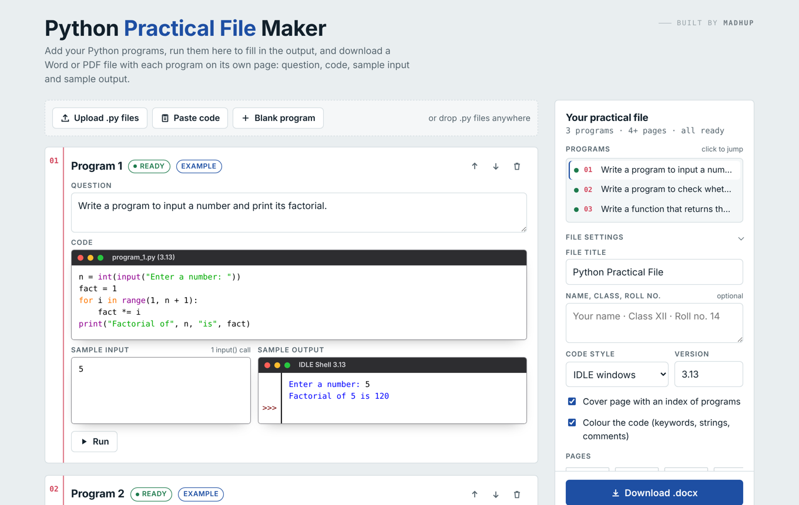

# Python Practical File Maker

Turn your Python programs into a ready-to-submit practical file. Add your code, run it in the browser, and download a Word or PDF document with one program per page.

**Live site:** [cs-file.vercel.app](https://cs-file.vercel.app)



## Features

- **Add programs your way.** Upload `.py` files, drag and drop them, paste code, or type it in.
- **Questions filled in automatically.** The comment or docstring at the top of each program becomes its question.
- **Runs your code in the browser.** Sample output is produced by actually running the program with your sample input.
- **Python IDLE look.** Code appears in an IDLE editor window and output in an IDLE Shell window, using IDLE's own colours.
- **Word and PDF export.** Each program gets its own page, with an optional cover page and index.
- **Saves as you go.** Your programs are kept in your browser between visits.
- **Private.** Nothing is uploaded; everything happens on your device.

## How to use

1. Add your programs by uploading `.py` files, pasting code, or clicking **Blank program**.
2. Check each program's **Question**.
3. In **Sample Input**, type what you would enter for each `input()`, one line per call.
4. Press **Run** to fill in the **Sample Output**.
5. Add your name and class, then click **Download .docx** or **Download PDF**.

### Writing questions in your code

Put the question at the top of the file as a comment or a docstring:

```python
# Q1. Write a program to find the sum of two numbers.
a = int(input("Enter a: "))
b = int(input("Enter b: "))
print("Sum =", a + b)
```

To paste several programs at once, separate them with a line containing only `#---`.

### Sample input

Each `input()` reads one line. For the program above:

```
12
30
```

If one `input()` reads several values with `.split()`, put them on the same line.

## Output format

Each program is placed on its own page with four sections:

| Section | Appearance |
|---|---|
| Question | Plain text |
| Code | IDLE editor window with syntax colours |
| Sample Input | White box |
| Sample Output | IDLE Shell window: output in blue, typed input in black, errors in red |

## Limitations

The code runs on [Skulpt](https://skulpt.org), a Python 3 interpreter written in JavaScript. Most school-level programs work, but some features are not supported:

- File handling (`open()` for writing, `pickle`, `csv`), `mysql.connector`, `numpy`, `pandas`
- `match`/`case`, the walrus operator `:=`, and `nonlocal`
- Some unformatted decimal results print differently from standard Python

For these programs, run them on your computer and paste the output into **Sample Output**. Your text is kept as it is.

## Built with

- HTML, CSS and JavaScript in a single file, with no build step and no backend
- [Skulpt](https://github.com/skulpt/skulpt) to run Python in the browser
- [JSZip](https://github.com/Stuk/jszip) to build `.docx` files
- [jsPDF](https://github.com/parallax/jsPDF) to build PDF files
- [DejaVu Sans Mono](https://dejavu-fonts.github.io) as the code font in PDFs

## Running locally

Open `index.html` in any modern browser. An internet connection is needed the first time so the libraries can load.

## Deploying

The site is a single static file. To host your own copy on Vercel, import this repository, set **Framework Preset** to **Other**, and deploy. Every push to the main branch updates the site.

## Author

Built by **Madhup**.
